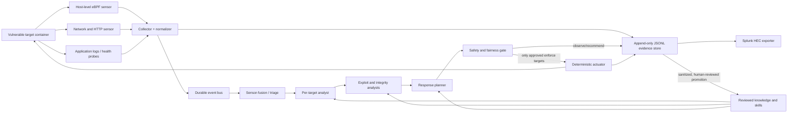

# Historical architecture plan for the original research pilot

This document records the original capture-the-flag pilot and its proposed architecture. It is historical context, not a description of universal defaults or production readiness. See the README for current behavior and limitations.

Status: initial architecture proposal; target manifests are still required.

## 1. Goals and non-goals

The system will observe attacks against intentionally vulnerable containers, correlate and explain attacker behavior, propose responses, and—on exactly two explicitly named targets—execute constrained mitigation or repair actions.

It must preserve the competition:

- Every target starts in `observe` mode.
- Only two target manifests may set `mode: enforce`.
- The intended vulnerable application and real flag remain present and reachable.
- A successful flag read is evidence, not a reason to delete, rotate, redact, or replace the flag.
- No blanket IP deny, null route, container shutdown, or permanent patch of the intended challenge path.
- Enforcement is narrow, reversible, time-limited, attributable, and automatically rolled back if health or flag-path probes fail.
- The attacker may compromise the workload, but must not be able to erase the authoritative evidence stream or directly control the defense agents.

This is a defensive research system for owned CTF infrastructure. It is not an autonomous offensive system and should have no ability to scan or act outside the declared lab network.

## 2. Architecture



### Trust boundaries

1. **Target data plane (assumed hostile):** vulnerable application plus optional unprivileged app-log forwarder. It has no model credentials, policy write access, or Docker/Kubernetes control socket.
2. **Node sensor plane:** host-level eBPF and network sensors watch container namespaces from outside the target. The sensor socket and policy directory are not mounted into targets.
3. **Analysis plane:** agents consume normalized, size-bounded evidence. They cannot directly execute inside targets.
4. **Action plane:** a small non-LLM actuator accepts signed, schema-valid action requests from an allowlist and records before/after state.
5. **Management plane:** operator approval, target manifests, skills, prompt versions, evaluation results, and Splunk export.

Host-level observation is essential: a target-local monitor can be killed or altered after compromise. Target-local logging is useful as one signal, never as the sole source of truth.

## 3. Sensor stack

Use a pluggable sensor interface so the lab can support Docker Compose and Kubernetes.

### Minimum viable Docker deployment

- Host-level Tracee or Falco for process execution, file access/change, privilege changes, namespace activity, and network-related runtime detections.
- Network visibility on the CTF bridge using Suricata or Zeek; use HTTP access logs or a transparent capture point where TLS termination permits it.
- Container runtime events and metadata (container ID, immutable image digest, labels, start time).
- Application logs, health probes, and challenge-specific canaries.
- Golden-image filesystem manifest for high-value paths, with hashes and ownership/mode metadata.

### Kubernetes option

- Prefer Tetragon when Kubernetes-aware eBPF selection and carefully scoped runtime enforcement are required.
- Tetragon/Falco/Tracee events are adapters into the same normalized event envelope; the rest of the system is unchanged.

Do not record flags, credentials, full environment blocks, or unbounded request bodies. Capture hashes, bounded excerpts after redaction, metadata, and references to access-controlled packet/evidence objects.

## 4. Agent roles

The "swarm" is a bounded workflow, not free-form peer-to-peer autonomy.

| Role | Responsibility | Allowed capabilities |
|---|---|---|
| Sensor fusion / triage | Deduplicate, correlate, score, open an incident | Read event bus; write findings |
| Per-target analyst | Maintain target timeline and distinguish expected service behavior from attacker activity | Read target profile and evidence; write analysis |
| Exploit analyst | Map behavior to the declared Exploit-DB/CVE material and identify prerequisites/post-exploitation | Read curated references and evidence only |
| Integrity analyst | Compare processes/files/configuration to image and target baseline | Request read-only snapshots; write diffs |
| Response planner | Produce typed candidate actions with evidence, confidence, TTL, rollback, and predicted CTF impact | Write proposals only |
| Safety/fairness arbiter | Apply deterministic policy plus optional second-model review; reject actions that threaten availability or challenge solvability | Approve/reject typed proposals |
| Actuator | Execute one allowlisted action and verify/rollback | Narrow privileged API; no model reasoning |
| Knowledge curator | Build a sanitized incident summary and candidate reusable lesson | Offline write to review queue only |

Every conclusion must carry evidence IDs. Raw attacker text is always untrusted data and never becomes an instruction to an agent.

## 5. Modes and response contract

Each target has a version-controlled manifest:

```yaml
target_id: pending
image_digest: pending
mode: observe # observe | recommend | enforce
enforcement_profile: none
intended_vulnerability:
  exploit_db_ids: []
  cves: []
flag_contract:
  health_probe: pending
  retrieval_probe: pending
allowed_actions: []
forbidden_actions:
  - null_route
  - blanket_ip_block
  - stop_target
  - remove_or_rotate_flag
  - permanently_patch_intended_vulnerability
lab_cidrs: []
```

Modes:

- `observe`: detect, analyze, and log. No mutation.
- `recommend`: create an exact action plan but do not execute it.
- `enforce`: available only for the two named targets and only for actions present in that target's allowlist.

Candidate graduated actions, subject to each target's manifest:

1. Increase capture depth for a process/session for a short TTL.
2. Snapshot the affected namespace and produce an integrity diff.
3. Apply bounded CPU/process/connection shaping to the malicious descendant cgroup, without a blanket source block.
4. Terminate a confirmed malicious child process while keeping the vulnerable service available.
5. Restore a modified non-flag file from the immutable image, preserve the malicious artifact in evidence storage, and verify the service.
6. Restart only the affected service process when repair cannot be applied live.
7. Restrict unexpected post-exploitation egress to the declared lab boundary, without cutting the attacker's observable session from telemetry.

Each action request requires: `incident_id`, target, evidence set, action type, exact resource, preconditions, confidence, TTL, rate limit, rollback, expected effect, and challenge-impact assessment. The actuator rejects missing/stale fields, undeclared targets, out-of-lab destinations, or an unavailable rollback.

For fairness, enforcement uses an "engagement envelope": limited actions per time window, cooldowns, mandatory service and flag-path probes, and automatic rollback. Detection of flag access alone never triggers prevention.

## 6. JSONL event model and Splunk export

Store one JSON object per line. Preserve raw normalized observations and all agent/action lifecycle records as separate immutable events.

```json
{"schema_version":"1.0.0","event_id":"01...","event_type":"defense.action.result","time":"2026-09-17T14:20:31.123456Z","observed_time":"2026-09-17T14:20:31.130001Z","target":{"id":"target-01","container_id":"sha256:...","image_digest":"sha256:...","mode":"enforce"},"incident_id":"inc-01...","trace_id":"...","actor":{"type":"actuator","id":"actuator-01","version":"git:..."},"severity":"high","confidence":0.97,"evidence_ids":["evt-..."],"decision":{"policy_version":"git:...","proposal_id":"prop-...","approval":"allowed"},"action":{"type":"restore_file","resource":"/app/config.php","ttl_seconds":300,"rollback_id":"rb-...","status":"succeeded"},"ctf":{"intended_path_impacted":false,"service_probe":"pass","flag_probe":"pass"},"integrity":{"previous_event_hash":"sha256:...","event_hash":"sha256:..."},"labels":{"run_id":"run-...","sensor":"integrity"}}
```

Required common fields:

- Schema/event identity: `schema_version`, `event_id`, `event_type`.
- Time: source `time` and collector `observed_time` in UTC.
- Scope: run, target, container/image, node, sensor, and target mode.
- Correlation: `incident_id`, `trace_id`, optional request/session/process lineage.
- Provenance: actor kind/ID/version, prompt/skill/model/policy versions where applicable.
- Assessment: severity, confidence, evidence IDs, ATT&CK/CVE/Exploit-DB tags when known.
- Safety: target mode, approval decision, CTF impact, probes, rollback.
- Integrity: append sequence and optional hash chain/signature.

Event types include `observation`, `finding`, `incident.opened`, `analysis`, `proposal`, `decision`, `action.request`, `action.result`, `rollback`, `health`, `agent.lifecycle`, and `knowledge.candidate`.

Write locally to rotated JSONL and export asynchronously. The Splunk adapter wraps each object in HEC metadata (`time`, `host`, `source`, `sourcetype`, `event`, indexed `fields`) and uses a stable sourcetype such as `ctf:defense:json`. A failed Splunk connection must not stall sensors; queue and retry with disk bounds and loss counters.

## 7. HerdR and OpenCode

### HerdR

Use HerdR for development, experiments, and human supervision:

- One named workspace per experiment/run.
- Panes for collector, replay harness, each specialist coding agent, tests, dashboards, and logs.
- CLI/socket automation to start agents, inspect state, wait for completion, and collect results.
- Persist run IDs and agent lifecycle events into the same audit stream through a small adapter.

HerdR is not the runtime authorization boundary or durable event bus. Terminal panes and screen state are operational ergonomics, not a security control.

### OpenCode

Use OpenCode custom agents for the specialist roles during development and optionally for bounded analysis workers. Each agent receives least-privilege permissions. Analysts get read-only evidence tools; planners can write proposals; no agent gets unrestricted `bash`, external network access, the container runtime socket, or actuator credentials.

Put portable repo skills under `.agents/skills/<skill-name>/SKILL.md`, which OpenCode can discover. Keep harness-specific agent definitions separate from portable knowledge.

## 8. Skills and knowledge lifecycle

Proposed repository layout:

```text
agents/                    # harness-specific role definitions
.agents/skills/
  ctf-target-onboarding/
  ctf-evidence-analysis/
  ctf-exploit-correlation/
  ctf-response-planning/
  ctf-fairness-review/
  ctf-incident-curation/
knowledge/
  targets/                 # manifests and normal-behavior profiles
  vulnerabilities/         # curated CVE/Exploit-DB notes, no weaponized automation
  playbooks/                # typed response patterns and rollbacks
  incidents/                # sanitized, approved summaries
schemas/                    # event, proposal, decision, action JSON Schemas
policies/                   # global and per-target action policies
sensors/                    # adapters and sensor configurations
collector/                  # normalization, redaction, JSONL and HEC output
controller/                 # workflow, gates, leases and actuator API
evals/                      # replay fixtures, scoring and fairness tests
deploy/                     # Docker Compose and/or Kubernetes manifests
```

Knowledge promotion is never automatic. The curator produces a candidate from a completed incident; a sanitizer removes secrets, flags, attacker-supplied instructions, unique player identifiers, and unsafe payloads; evaluation replays it; then a human approves a versioned merge. This prevents prompt injection and adversarial knowledge poisoning.

Skills should teach procedures and decision contracts. Target facts belong in versioned target profiles; incident evidence belongs in immutable storage; secrets belong in a secret manager. Do not blend these into prompts.

## 9. Delivery phases

### Phase 0 — Rules of engagement and target intake

- Receive target images/digests, runtime, ports, app versions, Exploit-DB/CVE references, expected benign behavior, flag contract, health probes, and lab network ranges.
- Name the two enforcement targets and agree their exact allowlisted actions.
- Define experiment IDs, retention/redaction rules, player privacy policy, and success thresholds.
- Threat-model the defender itself, especially sensor tampering, prompt injection, policy changes, and log loss.

Exit: signed target manifests and a machine-testable global safety policy.

### Phase 1 — Observe-only telemetry MVP

- Deploy host runtime sensor, network/app adapters, collector, durable queue, JSONL store, and Splunk HEC exporter.
- Build target identity/process lineage and clock synchronization.
- Add heartbeats, queue depth/loss metrics, log rotation, and redaction tests.
- Capture benign baselines before attack replay.

Exit: all targets produce correlated evidence while compromised target users cannot alter authoritative logs.

### Phase 2 — Analysis swarm

- Implement fusion, per-target, exploit, and integrity agents with strict typed I/O.
- Add incident timelines, evidence citations, confidence calibration, and budget/time limits.
- Run known Exploit-DB replays and novel variants in observe mode.

Exit: reproducible incident reports with measured false-positive/false-negative rates.

### Phase 3 — Recommendation and shadow enforcement

- Implement planner, deterministic fairness gate, action schema, and actuator in dry-run mode.
- Replay every proposed action against snapshots and record predicted versus actual outcomes.
- Add mandatory rollback and health/flag probes.

Exit: no unsafe schema-valid action in adversarial/fuzz tests; acceptable recommendation precision.

### Phase 4 — Two-target enforcement pilot

- Enable one allowlisted action on one target, then expand gradually.
- Use TTL, cooldown, action-rate caps, a circuit breaker, and a global operator kill switch.
- Automatically return to `recommend` on sensor loss, policy mismatch, probe failure, clock drift, or event-bus degradation.

Exit: target availability and challenge solvability remain above agreed thresholds while dwell time or destructive impact improves.

### Phase 5 — Knowledge and portability

- Create and validate the portable skills, reviewed knowledge packs, target adapter contract, and deployment profiles.
- Re-run the same eval suite on a different container architecture/orchestrator.
- Version prompts, skills, models, sensor rules, policies, and datasets in every run record.

Exit: a new target can be onboarded from its manifest without changing the core controller.

## 10. Evaluation metrics

- Mean/p95 detection, analysis, proposal, action, repair, and rollback latency.
- Detection recall and false-positive rate by attack phase.
- Action precision, rollback rate, and unsafe-action rejection rate.
- Service availability, intended-path availability, and successful flag retrieval rate versus an unprotected control group.
- Attacker dwell time, persistence success, unauthorized file/process lifetime, and recovery correctness.
- Sensor/log loss, out-of-order events, time drift, and evidence completeness.
- Agent cost, token/compute use, queue lag, and analysis timeout rate.
- Prompt-injection resistance and knowledge-poisoning rejection rate.

Use three cohorts where practical: no agent, observe/recommend agent, and constrained enforcement agent. Seed runs and retain exact image, policy, skill, model, and replay versions so results are scientifically comparable.

## 11. Information needed for target onboarding

For each target provide:

1. Image reference plus immutable digest, Dockerfile/Compose or Kubernetes manifest, and CPU architecture.
2. Application name/version, exposed ports/protocols, TLS termination point, and dependencies.
3. Exploit-DB IDs/CVEs and whether they are the intended player path.
4. Flag location/retrieval mechanism and a safe probe that verifies solvability without disclosing the flag.
5. Expected benign processes, writable paths, outbound connections, cron/jobs, and restart behavior.
6. Host OS/kernel, Docker/Kubernetes version, CNI/bridge details, and whether eBPF is available.
7. Lab CIDRs and explicit prohibition on reaching networks outside the lab.
8. Which two targets may enforce, plus allowed action types and downtime budget.
9. Splunk HEC destination conventions, index/sourcetype, retention, and required redactions (credentials can be supplied later through secrets management).
10. Research hypotheses and success thresholds for fairness, detection, and mitigation.

## 12. Initial implementation decisions to confirm after intake

- Tracee versus Falco for the Docker MVP; Tetragon is favored when Kubernetes-specific enforcement is required.
- NATS JetStream versus another existing durable bus already available in the lab.
- Go versus Python for the controller and actuator; the actuator should remain small, typed, and easy to audit.
- Local object store versus the lab's existing evidence store.
- Local models versus remote inference, based on data policy, latency, and network isolation requirements.

## 13. Container footprint and external integrations

### Single-host MVP

For `N` vulnerable targets, use `N + 7` running containers:

| Count | Container | Purpose |
|---:|---|---|
| `N` | Vulnerable targets | One container per CTF target, unless a target already requires multiple application containers |
| 1 | Runtime sensor | Host-level Tracee or Falco visibility across all target containers |
| 1 | Network sensor | Suricata/Zeek visibility on the isolated CTF bridge |
| 1 | Collector | Normalize, redact, correlate, write JSONL, and export to Splunk |
| 1 | Event bus | Durable NATS JetStream queue |
| 1 | Agent runtime/controller | Run the logical analyst roles as isolated workers and coordinate incidents |
| 1 | Actuator | Execute schema-valid allowlisted actions for the two enforcement targets only |
| 1 | Integration gateway | Discord notifications/commands and the OpenCode-facing API/MCP boundary |

The append-only JSONL evidence store can begin as a dedicated host volume. Add one object-store container when packet captures, filesystem artifacts, or longer retention require it. Splunk is assumed to be external. If a dedicated OpenCode server is containerized with the stack, the total is `N + 8`; otherwise OpenCode connects remotely through the integration gateway.

Do not deploy one LLM container per role in the MVP. The roles are logical security and context boundaries inside the agent runtime. Split them into separate worker containers only for independent scaling, model isolation, or research comparisons.

### Scaling formula

For multiple Docker/Kubernetes hosts, a practical non-HA estimate is:

```text
total = target_workload_containers + (2 × target_hosts) + 6 central services
        + optional_object_store + optional_opencode_server + extra_agent_workers
```

The two per-host services are runtime and network sensors. The six central services are collector, event bus, controller/worker, actuator, integration gateway, and the durable evidence service once it is separated from local JSONL volumes. High availability will add replicas and therefore should be sized after event-rate measurements.

### Discord integration

Discord can provide two levels of integration through the integration gateway:

1. **Outbound notification:** webhook messages for incident opened/updated/closed, degraded sensors, proposed actions, action results, and rollback events.
2. **Interactive operations:** a Discord application with role-restricted slash commands such as `/defense status`, `/incident show`, `/proposal list`, and `/proposal approve`.

Discord is not an authoritative evidence store or actuator. Interactive commands create audited approval events in the controller; they never call Docker/Kubernetes or the actuator directly. Enforcement approvals should require a permitted Discord role, interaction-signature validation, an incident/proposal ID, proposal freshness checks, and preferably a second confirmation for high-impact actions. Every Discord request and result is written to JSONL.

Messages must exclude flags, credentials, raw exploit bodies, player secrets, and unrestricted log excerpts. Use short summaries plus incident IDs, rate limiting, deduplication, and one Discord thread per incident when desired. Webhook/bot credentials remain in a secret manager and never enter target containers or agent prompts.

### OpenCode integration

Expose a narrow local or remote MCP server from the integration gateway. Recommended tools are:

- `defense_list_targets`
- `defense_get_status`
- `defense_list_incidents`
- `defense_get_timeline`
- `defense_get_evidence_metadata`
- `defense_create_analysis`
- `defense_create_proposal`
- `defense_get_action_result`

OpenCode analysts may read sanitized evidence and submit typed analysis or response proposals. There should be no `execute_shell`, `docker_exec`, `apply_policy`, or generic HTTP-request tool. Action execution remains behind the deterministic safety gate and actuator.

Use OpenCode project skills under `.agents/skills/`, per-role agents with explicit tool permissions, and either custom tools or MCP for the gateway. The OpenCode server API and event stream may be used to track session lifecycle and add it to the audit log. HerdR can supervise these OpenCode sessions during experiments without becoming part of the target trust boundary.
